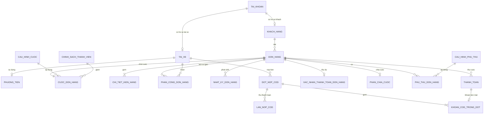

# CHƯƠNG 3. THIẾT KẾ DỮ LIỆU

Phạm vi chương này là schema SQL Server `mini_ong_vang_design_v1` của Mini Ông Vàng, được quản lý bằng Flyway V1–V12. Nguồn đối chiếu là entity/DAO hiện hành, các migration trong `src/backend/src/main/resources/db/designV1/sqlserver` và catalog SQL Server tại ngày 15/10/2026. V12 chỉ bỏ một index trùng; không đổi bảng hoặc dữ liệu. Sau khi chạy V12, schema ứng dụng có **26 bảng, 206 cột, 36 khóa ngoại, 130 CHECK và 65 index (gồm 26 index khóa chính)**. Không có FK/CHECK bị tắt hoặc `NOT TRUSTED` ở lần kiểm tra này.

Trong SSMS còn có `flyway_schema_history` (lịch sử migration), `demo_seed_manifest` (dấu phiên bản dữ liệu mẫu) và có thể có `sysdiagrams` (do SSMS tạo). Chúng không nằm trong 26 bảng ứng dụng. Database cũ `mini_ong_vang` cũng không phải schema hiện hành của backend.

## 3.1 Mô hình thực thể kết hợp (ERD) mức khái niệm

ERD dưới đây mô tả các quan hệ nghiệp vụ chính. Các bảng kỹ thuật như báo giá tạm, khóa chống tạo đơn lặp, OTP và rate-limit được trình bày ở lược đồ vật lý, không xem là đối tượng nghiệp vụ độc lập.

`tai_khoan` giữ vai trò chung; chỉ khách và tài xế có hồ sơ riêng. Một đơn có nhiều kiện, sự kiện, lần phân công và lần thử thanh toán nhưng tối đa một xác nhận thu đủ và một bản chia cước. Một chính sách phụ thu có thể dùng cho nhiều đơn và một đơn có thể áp dụng nhiều chính sách; `phu_thu_don_hang` là thực thể liên kết của quan hệ nhiều–nhiều.

## 3.2 Chuẩn hóa dữ liệu

- **1NF:** Mỗi cột quan hệ chứa một giá trị nguyên tử; các tập lặp được tách thành kiện hàng, sự kiện, lần thanh toán và lần phân công. JSON tại `bao_gia`, `yeu_cau_tao_don`, sự kiện tích hợp và audit là payload/snapshot bất biến để phát lại hoặc đối chiếu, không thay thế khóa ngoại nghiệp vụ.
- **2NF:** `phu_thu_don_hang` dùng khóa ghép `(ma_don, ma_phu_thu)` và không chứa thuộc tính phụ thuộc một nửa khóa. `PhuThuDonHangId` là lớp `@Embeddable` mô tả khóa ghép cho JPA, **không tạo bảng thứ hai**. `khoan_cod_trong_dot` dùng khóa ghép `(ma_dot, ma_giao_dich_cuoc)`; `so_tien` là số tiền chốt cho đúng cặp đó.
- **3NF:** Thông tin đăng nhập nằm ở `tai_khoan`, hồ sơ riêng ở `khach_hang`/`tai_xe`; biểu phí và chính sách có phiên bản riêng. Đơn tham chiếu các phiên bản đã áp dụng, không chép toàn bộ thông tin chính sách vào đơn.
- **Snapshot có chủ đích:** Cước theo km/kg, tổng kg, số tiền COD, tổng cước và phần chia 20/80 được chốt tại thời điểm nghiệp vụ để lịch sử không thay đổi khi chính sách hoặc trạng thái hiện tại đổi. Đây là dữ liệu lịch sử cần bảo toàn, không phải bảng dư tùy tiện. `yeu_cau_tao_don` lưu JSON yêu cầu/kết quả và khóa idempotency để gọi tạo đơn lặp không sinh đơn thứ hai; nó là entity lưu DB, không phải DTO `CreateOrder` của HTTP.

Các quy tắc liên bảng như “giao dịch được xác nhận thuộc đúng đơn”, “một tài xế không nhận hai đơn đang mở” và “tổng tiền COD bằng các khoản thành phần” được bảo vệ bằng FK/UNIQUE/CHECK và kiểm tra trong transaction; không thể diễn đạt hết bằng một CHECK trên một hàng.

## 3.3 Lược đồ cơ sở dữ liệu

Lược đồ vật lý dùng khóa định danh dạng chuỗi, `decimal` cho tiền/khối lượng/quãng đường và `datetime2` cho thời điểm. Các enum Java lưu bằng chuỗi. Hibernate dùng `validate`; Flyway là nguồn tạo/sửa schema, nên không dùng JPA tự sinh bảng khi chạy ứng dụng.

### 3.3.1 Danh sách bảng và ràng buộc

**PK** là khóa chính; **FK** là khóa ngoại; **UQ** là khóa duy nhất. Một số FK gồm nhiều cột được đếm là một ràng buộc. Nhóm “SQL/DAO” vẫn là bảng ứng dụng: code dùng native SQL thay cho JPA entity vì luồng COD, doanh thu và rate-limit cần truy vấn/tổng hợp chuyên biệt.

| Bảng | Vai trò / ánh xạ Java | PK | FK tham chiếu |
| --- | --- | --- | --- |
| `auth_rate_limit` | Kỹ thuật; `SQL/DAO` | `bucket_key` | — |
| `bao_gia` | Kỹ thuật; `BaoGia` | `ma_bao_gia` | `cau_hinh_cuoc`, `khach_hang` |
| `cau_hinh_cuoc` | Nghiệp vụ/tích hợp; `BieuPhi` | `ma_bieu_phi` | — |
| `cau_hinh_phu_thu` | Nghiệp vụ/tích hợp; `ChinhSachPhuThu` | `ma_phu_thu` | — |
| `chi_tiet_kien_hang` | Nghiệp vụ/tích hợp; `KienHang` | `ma_kien` | `don_hang` |
| `chinh_sach_thanh_vien` | Nghiệp vụ/tích hợp; `ChinhSachThanhVien` | `ma_chinh_sach` | — |
| `cuoc_don_hang` | Nghiệp vụ/tích hợp; `CuocDonHang` | `ma_don` | `cau_hinh_cuoc`, `chinh_sach_thanh_vien`, `don_hang` |
| `don_hang` | Nghiệp vụ/tích hợp; `DonHang` | `ma_don` | `khach_hang`, `tai_khoan` |
| `dot_nop_cod` | Nghiệp vụ/tích hợp; `SQL/DAO` | `ma_dot` | `tai_khoan`, `tai_xe` |
| `khach_hang` | Nghiệp vụ/tích hợp; `KhachHang` | `ma_kh` | `tai_khoan` |
| `khoan_cod_trong_dot` | Nghiệp vụ/tích hợp; `SQL/DAO` | `ma_dot, ma_giao_dich_cuoc` | `dot_nop_cod`, `thanh_toan` |
| `lan_nop_cod` | Nghiệp vụ/tích hợp; `SQL/DAO` | `ma_lan_nop` | `dot_nop_cod` |
| `nhat_ky_don_hang` | Nghiệp vụ/tích hợp; `SuKienDonHang` | `ma_su_kien` | `don_hang`, `tai_khoan` |
| `nhat_ky_kiem_toan` | Kỹ thuật; `NhatKyKiemToan` | `ma_audit` | `tai_khoan` |
| `password_reset_challenge` | Kỹ thuật; `PasswordResetChallenge` | `ma_tk` | `tai_khoan` |
| `phan_chia_cuoc` | Nghiệp vụ/tích hợp; `SQL/DAO` | `ma_don` | `don_hang`, `phan_cong_don_hang`, `thanh_toan` |
| `phan_cong_don_hang` | Nghiệp vụ/tích hợp; `PhanCongDonHang` | `ma_phan_cong` | `don_hang`, `tai_khoan`, `tai_xe` |
| `phu_thu_don_hang` | Nghiệp vụ/tích hợp; `PhuThuDonHang` | `ma_don, ma_phu_thu` | `cau_hinh_phu_thu`, `don_hang` |
| `phuong_tien` | Nghiệp vụ/tích hợp; `PhuongTien` | `ma_phuong_tien` | `tai_xe` |
| `su_kien_nop_cod` | Nghiệp vụ/tích hợp; `SQL/DAO` | `ma_su_kien` | `lan_nop_cod` |
| `su_kien_thanh_toan` | Nghiệp vụ/tích hợp; `SuKienThanhToan` | `ma_su_kien` | `thanh_toan` |
| `tai_khoan` | Nghiệp vụ/tích hợp; `TaiKhoan` | `ma_tk` | — |
| `tai_xe` | Nghiệp vụ/tích hợp; `TaiXe` | `ma_tx` | `tai_khoan` |
| `thanh_toan` | Nghiệp vụ/tích hợp; `LanThanhToan` | `ma_giao_dich` | `don_hang`, `tai_khoan` |
| `xac_nhan_thanh_toan_don_hang` | Nghiệp vụ/tích hợp; `XacNhanThanhToanDonHang` | `ma_don` | `don_hang`, `thanh_toan` |
| `yeu_cau_tao_don` | Kỹ thuật; `YeuCauTaoDon` | `request_id` | `don_hang`, `tai_khoan` |

**Ràng buộc đáng chú ý.** Khóa duy nhất bảo vệ `username`, SĐT không NULL, CCCD/GPLX tài xế, biển số xe, thứ tự kiện trong đơn, thứ tự sự kiện trong đơn, mã tham chiếu đối tác, khóa idempotency COD và khóa callback. UNIQUE có điều kiện giới hạn một phân công đang mở cho mỗi đơn/tài xế, một thanh toán đang chờ/chưa rõ cho mỗi đơn và một lần nộp COD còn hiệu lực cho mỗi đợt. Khóa ghép trên `xac_nhan_thanh_toan_don_hang` kiểm tra giao dịch thuộc cùng đơn; FK riêng lẻ không đủ để thay thế ràng buộc này. CHECK kiểm tra miền trạng thái, số tiền không âm, thời gian hợp lệ, JSON hợp lệ và hình dạng sự kiện. Sáu trigger đang bật: ba trigger bảo vệ chính sách đã công bố, hai trigger kiểm tra vai trò của hồ sơ khách/tài xế và một trigger chặn đổi vai trò tài khoản.

`password_reset_challenge` có PK/FK `ma_tk` và chỉ giữ thử thách hiện hành; `auth_rate_limit` có PK `bucket_key` là hash, không lưu email/SĐT thô trong khóa. Số dòng bằng 0 trong các bảng OTP, audit hoặc callback là trạng thái bình thường khi chưa phát sinh sự kiện.

### 3.3.2 Từ điển dữ liệu

Kiểu và NULL dưới đây lấy từ catalog SQL Server sau V11; V12 không đổi cột. **NN**: không cho NULL; **N**: cho NULL. `PK/FK` nêu vai trò khóa của cột; ràng buộc UNIQUE nhiều cột được giải thích ở 3.3.1 và 3.4. `nvarchar` ghi độ dài theo ký tự, `varchar` theo byte; `datetime2` ghi độ chính xác phần giây.

#### `auth_rate_limit`

Bộ đếm giới hạn yêu cầu khôi phục mật khẩu.

| Cột | Kiểu SQL Server | NULL | Khóa | Ý nghĩa |
| --- | --- | --- | --- | --- |
| `bucket_key` | `varchar(64)` | NN | PK | Khóa SHA-256 của nhóm giới hạn lượt. |
| `expires_at` | `datetime2(6)` | NN | — | Thời điểm hết hạn của bản ghi kỹ thuật. |
| `request_count` | `int` | NN | — | Số yêu cầu trong cửa sổ giới hạn. |

#### `bao_gia`

Báo giá ngắn hạn cùng dữ liệu yêu cầu/kết quả.

| Cột | Kiểu SQL Server | NULL | Khóa | Ý nghĩa |
| --- | --- | --- | --- | --- |
| `ma_bao_gia` | `nvarchar(36)` | NN | PK | Mã báo giá. |
| `ma_kh` | `nvarchar(36)` | NN | FK | Mã hồ sơ khách hàng. |
| `ma_bieu_phi` | `nvarchar(36)` | NN | FK | Mã phiên bản biểu phí. |
| `tao_luc` | `datetime2(3)` | NN | — | Thời điểm tạo bản ghi. |
| `het_han_luc` | `datetime2(3)` | NN | — | Thời điểm báo giá hết hạn. |
| `yeu_cau_json` | `nvarchar(max)` | NN | — | JSON yêu cầu báo giá để kiểm tra lại khi tạo đơn. |
| `ket_qua_json` | `nvarchar(max)` | NN | — | JSON kết quả báo giá để phát lại. |

#### `cau_hinh_cuoc`

Phiên bản biểu phí cơ bản, km và khối lượng.

| Cột | Kiểu SQL Server | NULL | Khóa | Ý nghĩa |
| --- | --- | --- | --- | --- |
| `ma_bieu_phi` | `nvarchar(36)` | NN | PK | Mã phiên bản biểu phí. |
| `ten_bieu_phi` | `nvarchar(100)` | NN | — | Tên hiển thị biểu phí. |
| `cuoc_co_ban` | `decimal(15,2)` | NN | — | Mức cước cơ bản trong biểu phí. |
| `don_gia_km` | `decimal(15,2)` | NN | — | Đơn giá mỗi km. |
| `km_toi_thieu` | `decimal(10,2)` | NN | — | Giới hạn dưới quãng đường áp dụng. |
| `km_toi_da` | `decimal(10,2)` | N | — | Giới hạn trên quãng đường áp dụng. |
| `hieu_luc_tu` | `datetime2(3)` | NN | — | Bắt đầu hiệu lực chính sách. |
| `hieu_luc_den` | `datetime2(3)` | N | — | Kết thúc hiệu lực chính sách. |
| `trang_thai` | `nvarchar(40)` | NN | — | Trạng thái hiện tại của bản ghi. Mặc định: `(N'NHAP')`. |
| `phien_ban` | `int` | NN | — | Số phiên bản biểu phí. Mặc định: `((1))`. |
| `kg_bao_gom` | `decimal(10,2)` | NN | — | Số kg nằm trong cước cơ bản. Mặc định: `((1.00))`. |
| `don_gia_kg` | `decimal(15,2)` | NN | — | Đơn giá phần khối lượng vượt ngưỡng. Mặc định: `((3000.00))`. |
| `kg_toi_da` | `decimal(10,2)` | NN | — | Khối lượng tối đa biểu phí cho phép. Mặc định: `((30.00))`. |

#### `cau_hinh_phu_thu`

Phiên bản chính sách phụ thu.

| Cột | Kiểu SQL Server | NULL | Khóa | Ý nghĩa |
| --- | --- | --- | --- | --- |
| `ma_phu_thu` | `nvarchar(36)` | NN | PK | Mã phiên bản chính sách phụ thu. |
| `ma_loai_phu_thu` | `nvarchar(30)` | NN | — | Mã loại phụ thu. |
| `ten_phu_thu` | `nvarchar(150)` | NN | — | Tên hiển thị chính sách phụ thu. |
| `so_tien` | `decimal(15,2)` | NN | — | Số tiền của phụ thu hoặc khoản mục. |
| `hieu_luc_tu` | `datetime2(3)` | NN | — | Bắt đầu hiệu lực chính sách. |
| `hieu_luc_den` | `datetime2(3)` | N | — | Kết thúc hiệu lực chính sách. |
| `trang_thai` | `nvarchar(40)` | NN | — | Trạng thái hiện tại của bản ghi. Mặc định: `(N'NHAP')`. |

#### `chi_tiet_kien_hang`

Các kiện hàng thuộc một đơn.

| Cột | Kiểu SQL Server | NULL | Khóa | Ý nghĩa |
| --- | --- | --- | --- | --- |
| `ma_kien` | `nvarchar(36)` | NN | PK | Mã kiện hàng. |
| `ma_don` | `nvarchar(36)` | NN | FK | Mã đơn hàng. |
| `thu_tu` | `int` | NN | — | Thứ tự kiện hoặc sự kiện trong đơn. |
| `loai_hang_hoa` | `nvarchar(100)` | NN | — | Loại hàng trong kiện. |
| `khoi_luong_kg` | `decimal(10,2)` | NN | — | Khối lượng kiện theo kg. |
| `ghi_chu_bao_quan` | `nvarchar(500)` | N | — | Lưu ý bảo quản kiện. |

#### `chinh_sach_thanh_vien`

Phiên bản chính sách giảm giá theo hạng.

| Cột | Kiểu SQL Server | NULL | Khóa | Ý nghĩa |
| --- | --- | --- | --- | --- |
| `ma_chinh_sach` | `nvarchar(36)` | NN | PK | Mã chính sách thành viên. |
| `ma_hang` | `nvarchar(40)` | NN | — | Mã hạng thành viên. |
| `ty_le_giam` | `decimal(5,2)` | NN | — | Tỷ lệ giảm giá theo chính sách thành viên. |
| `hieu_luc_tu` | `datetime2(3)` | NN | — | Bắt đầu hiệu lực chính sách. |
| `hieu_luc_den` | `datetime2(3)` | N | — | Kết thúc hiệu lực chính sách. |
| `trang_thai` | `nvarchar(40)` | NN | — | Trạng thái hiện tại của bản ghi. Mặc định: `(N'NHAP')`. |

#### `cuoc_don_hang`

Ảnh chụp các thành phần cước khi tạo đơn.

| Cột | Kiểu SQL Server | NULL | Khóa | Ý nghĩa |
| --- | --- | --- | --- | --- |
| `ma_don` | `nvarchar(36)` | NN | PK/FK | Mã đơn hàng. |
| `ma_bieu_phi` | `nvarchar(36)` | NN | FK | Mã phiên bản biểu phí. |
| `ma_chinh_sach_giam` | `nvarchar(36)` | N | FK | Mã chính sách giảm đã áp dụng. |
| `cuoc_goc` | `decimal(15,2)` | NN | — | Tổng trước phụ thu/giảm giá: `cuoc_km + cuoc_khoi_luong`. |
| `tien_giam_gia` | `decimal(15,2)` | NN | — | Số tiền giảm giá đã chốt. |
| `cuoc_km` | `decimal(15,2)` | NN | — | Phần cước theo quãng đường đã chốt. Mặc định: `((0))`. |
| `cuoc_khoi_luong` | `decimal(15,2)` | NN | — | Phần cước theo khối lượng đã chốt. Mặc định: `((0))`. |
| `tong_khoi_luong_kg` | `decimal(10,2)` | NN | — | Tổng kg của các kiện khi chốt cước. Mặc định: `((0))`. |
| `phien_ban_bieu_phi` | `int` | NN | — | Phiên bản biểu phí được chốt trên đơn. Mặc định: `((1))`. |

#### `don_hang`

Thông tin và trạng thái giao hàng.

| Cột | Kiểu SQL Server | NULL | Khóa | Ý nghĩa |
| --- | --- | --- | --- | --- |
| `ma_don` | `nvarchar(36)` | NN | PK | Mã đơn hàng. |
| `ma_kh` | `nvarchar(36)` | NN | FK | Mã hồ sơ khách hàng. |
| `ma_tk_tao` | `nvarchar(36)` | NN | FK | Mã tài khoản tạo đơn. |
| `thoi_gian_tao` | `datetime2(3)` | NN | — | Thời điểm tạo đơn. |
| `trang_thai` | `nvarchar(40)` | NN | — | Trạng thái hiện tại của bản ghi. Mặc định: `(N'CHO_GAN')`. |
| `diem_lay_hang` | `nvarchar(255)` | NN | — | Địa chỉ lấy hàng đã chốt. |
| `diem_giao_hang` | `nvarchar(255)` | NN | — | Địa chỉ giao hàng đã chốt. |
| `sdt_nguoi_nhan` | `nvarchar(10)` | NN | — | Số điện thoại người nhận tại thời điểm tạo đơn. |
| `quang_duong_km` | `decimal(10,2)` | NN | — | Quãng đường tính cước theo km. |
| `thoi_gian_du_kien_giay` | `int` | NN | — | Thời gian lộ trình dự kiến, tính bằng giây. |
| `nguon_lo_trinh` | `nvarchar(40)` | NN | — | Nguồn cung cấp lộ trình. |
| `ghi_chu_giao_hang` | `nvarchar(500)` | N | — | Chỉ dẫn giao hàng. |
| `thoi_gian_hoan_tat` | `datetime2(3)` | N | — | Thời điểm hoàn tất đơn. |
| `thoi_gian_huy` | `datetime2(3)` | N | — | Thời điểm hủy đơn. |
| `ly_do_huy` | `nvarchar(500)` | N | — | Lý do hủy đơn. |
| `ten_nguoi_nhan` | `nvarchar(100)` | N | — | Tên người nhận tại thời điểm tạo đơn. |
| `ben_thanh_toan` | `nvarchar(20)` | NN | — | Bên chịu cước đã chốt khi tạo đơn. Mặc định: `(N'NGUOI_DAT')`. |
| `phuong_thuc_thanh_toan` | `nvarchar(20)` | NN | — | Phương thức trả cước đã chốt trên đơn. Mặc định: `(N'TIEN_MAT')`. |

#### `dot_nop_cod`

Đợt đối soát tiền mặt của một tài xế.

| Cột | Kiểu SQL Server | NULL | Khóa | Ý nghĩa |
| --- | --- | --- | --- | --- |
| `ma_dot` | `nvarchar(36)` | NN | PK | Mã đợt nộp COD. |
| `ma_tx` | `nvarchar(36)` | NN | FK | Mã hồ sơ tài xế. |
| `ma_tk_dieu_phoi` | `nvarchar(36)` | NN | FK | Mã tài khoản điều phối thực hiện. |
| `khoa_idempotency` | `nvarchar(100)` | NN | — | Khóa chống tạo trùng do bên gọi cung cấp. |
| `tao_luc` | `datetime2(3)` | NN | — | Thời điểm tạo bản ghi. |
| `tong_tien` | `decimal(15,2)` | NN | — | Tổng tiền của đợt COD. |
| `trang_thai` | `nvarchar(30)` | NN | — | Trạng thái hiện tại của bản ghi. |
| `xac_nhan_luc` | `datetime2(3)` | N | — | Thời điểm xác nhận nộp COD thành công. |

#### `khach_hang`

Hồ sơ khách và hạng thành viên hiện tại.

| Cột | Kiểu SQL Server | NULL | Khóa | Ý nghĩa |
| --- | --- | --- | --- | --- |
| `ma_kh` | `nvarchar(36)` | NN | PK | Mã hồ sơ khách hàng. |
| `ma_tk` | `nvarchar(36)` | NN | FK | Mã tài khoản. |
| `dia_chi_mac_dinh` | `nvarchar(255)` | N | — | Địa chỉ thường dùng của khách. |
| `ma_hang` | `nvarchar(40)` | NN | — | Mã hạng thành viên. Mặc định: `(N'THUONG')`. |
| `thanh_vien_tu` | `datetime2(3)` | N | — | Thời điểm bắt đầu hạng thành viên hiện tại. |
| `thanh_vien_den` | `datetime2(3)` | N | — | Thời điểm kết thúc hạng thành viên hiện tại. |

#### `khoan_cod_trong_dot`

Các khoản cước tiền mặt thuộc đợt COD.

| Cột | Kiểu SQL Server | NULL | Khóa | Ý nghĩa |
| --- | --- | --- | --- | --- |
| `ma_dot` | `nvarchar(36)` | NN | PK/FK | Mã đợt nộp COD. |
| `ma_giao_dich_cuoc` | `nvarchar(36)` | NN | PK/FK | Mã giao dịch cước liên quan. |
| `so_tien` | `decimal(15,2)` | NN | — | Số tiền của phụ thu hoặc khoản mục. |

#### `lan_nop_cod`

Các lần thanh toán VNPay cho một đợt COD.

| Cột | Kiểu SQL Server | NULL | Khóa | Ý nghĩa |
| --- | --- | --- | --- | --- |
| `ma_lan_nop` | `nvarchar(36)` | NN | PK | Mã lần thử nộp COD. |
| `ma_dot` | `nvarchar(36)` | NN | FK | Mã đợt nộp COD. |
| `ma_tham_chieu` | `nvarchar(100)` | NN | — | Mã tham chiếu gửi cổng thanh toán. |
| `trang_thai` | `nvarchar(30)` | NN | — | Trạng thái hiện tại của bản ghi. |
| `payment_url` | `nvarchar(2048)` | NN | — | URL VNPay tạo cho lần thử thanh toán. |
| `tao_luc` | `datetime2(3)` | NN | — | Thời điểm tạo bản ghi. |
| `thu_luc` | `datetime2(3)` | N | — | Thời điểm thu được tiền. |
| `so_tien_thuc_nhan` | `decimal(15,2)` | N | — | Số tiền giao dịch thực nhận. |
| `ma_giao_dich_doi_tac` | `nvarchar(100)` | N | — | Mã giao dịch do đối tác thanh toán cấp. |

#### `nhat_ky_don_hang`

Dòng sự kiện trạng thái và sự cố của đơn.

| Cột | Kiểu SQL Server | NULL | Khóa | Ý nghĩa |
| --- | --- | --- | --- | --- |
| `ma_su_kien` | `nvarchar(36)` | NN | PK | Mã sự kiện. |
| `ma_don` | `nvarchar(36)` | NN | FK | Mã đơn hàng. |
| `thu_tu` | `int` | NN | — | Thứ tự kiện hoặc sự kiện trong đơn. |
| `loai_su_kien` | `nvarchar(40)` | NN | — | Loại sự kiện đơn hàng. |
| `trang_thai_truoc` | `nvarchar(40)` | N | — | Trạng thái đơn trước sự kiện. |
| `trang_thai_sau` | `nvarchar(40)` | NN | — | Trạng thái đơn sau sự kiện. |
| `thoi_gian` | `datetime2(3)` | NN | — | Thời điểm sự kiện. |
| `ma_tk_thuc_hien` | `nvarchar(36)` | NN | FK | Mã tài khoản thực hiện sự kiện. |
| `loai_su_co` | `nvarchar(40)` | N | — | Loại sự cố giao hàng. |
| `ghi_chu` | `nvarchar(500)` | N | — | Ghi chú của sự kiện hoặc thao tác. |

#### `nhat_ky_kiem_toan`

Lịch sử thao tác quản trị cần kiểm toán.

| Cột | Kiểu SQL Server | NULL | Khóa | Ý nghĩa |
| --- | --- | --- | --- | --- |
| `ma_audit` | `nvarchar(36)` | NN | PK | Mã dòng kiểm toán. |
| `ma_tk_thuc_hien` | `nvarchar(36)` | N | FK | Mã tài khoản thực hiện sự kiện. |
| `nguon` | `nvarchar(40)` | NN | — | Nguồn phát sinh sự kiện/thao tác. |
| `loai_doi_tuong` | `nvarchar(50)` | NN | — | Loại đối tượng bị tác động. |
| `ma_doi_tuong` | `nvarchar(100)` | NN | — | Mã đối tượng bị tác động. |
| `hanh_dong` | `nvarchar(40)` | NN | — | Loại thao tác được kiểm toán. |
| `thoi_gian` | `datetime2(3)` | NN | — | Thời điểm sự kiện. |
| `truoc_json` | `nvarchar(max)` | N | — | Ảnh chụp JSON trước thao tác. |
| `sau_json` | `nvarchar(max)` | N | — | Ảnh chụp JSON sau thao tác. |
| `ly_do` | `nvarchar(500)` | N | — | Lý do thao tác hoặc kết thúc. |

#### `password_reset_challenge`

OTP và reset token tạm thời của tài khoản.

| Cột | Kiểu SQL Server | NULL | Khóa | Ý nghĩa |
| --- | --- | --- | --- | --- |
| `ma_tk` | `nvarchar(36)` | NN | PK/FK | Mã tài khoản. |
| `otp_hash` | `nvarchar(255)` | N | — | Hash của OTP, không lưu mã rõ. |
| `otp_expires_at` | `datetime2(6)` | NN | — | Thời điểm mã OTP hết hạn. |
| `attempts` | `int` | NN | — | Số lần nhập OTP sai. Mặc định: `((0))`. |
| `token_hash` | `nvarchar(64)` | N | — | Hash của reset token, không lưu token rõ. |
| `token_expires_at` | `datetime2(6)` | N | — | Thời điểm reset token hết hạn. |
| `auth_version` | `bigint` | NN | — | Phiên bản xác thực dùng vô hiệu hóa phiên/token cũ. |

#### `phan_chia_cuoc`

Ảnh chụp tỷ lệ và số tiền chia cho công ty/tài xế.

| Cột | Kiểu SQL Server | NULL | Khóa | Ý nghĩa |
| --- | --- | --- | --- | --- |
| `ma_don` | `nvarchar(36)` | NN | PK/FK | Mã đơn hàng. |
| `ma_phan_cong` | `nvarchar(36)` | NN | FK | Mã lượt phân công. |
| `ma_giao_dich_cuoc` | `nvarchar(36)` | N | FK | Mã giao dịch cước liên quan. |
| `phien_ban_chinh_sach` | `int` | NN | — | Phiên bản chính sách chia cước. Mặc định: `((1))`. |
| `ty_le_cong_ty` | `decimal(5,4)` | NN | — | Tỷ lệ công ty được hưởng tại lúc chia cước. |
| `tong_cuoc` | `decimal(15,2)` | NN | — | Tổng cước đã chốt để chia. |
| `tien_cong_ty` | `decimal(15,2)` | NN | — | Phần tiền công ty được hưởng, dạng snapshot. |
| `tien_tai_xe` | `decimal(15,2)` | NN | — | Phần tiền tài xế được hưởng, dạng snapshot. |
| `ghi_nhan_luc` | `datetime2(3)` | NN | — | Thời điểm ghi nhận phần chia cước. |

#### `phan_cong_don_hang`

Lịch sử gán và kết thúc phân công tài xế.

| Cột | Kiểu SQL Server | NULL | Khóa | Ý nghĩa |
| --- | --- | --- | --- | --- |
| `ma_phan_cong` | `nvarchar(36)` | NN | PK | Mã lượt phân công. |
| `ma_don` | `nvarchar(36)` | NN | FK | Mã đơn hàng. |
| `ma_tx` | `nvarchar(36)` | NN | FK | Mã hồ sơ tài xế. |
| `ma_tk_dieu_phoi` | `nvarchar(36)` | NN | FK | Mã tài khoản điều phối thực hiện. |
| `bat_dau_luc` | `datetime2(3)` | NN | — | Thời điểm bắt đầu phân công. |
| `ket_thuc_luc` | `datetime2(3)` | N | — | Thời điểm kết thúc phân công. |
| `ket_qua_ket_thuc` | `nvarchar(40)` | N | — | Kết quả đóng phân công. |
| `ly_do` | `nvarchar(500)` | N | — | Lý do thao tác hoặc kết thúc. |

#### `phu_thu_don_hang`

Liên kết đơn với các phiên bản phụ thu đã áp dụng.

| Cột | Kiểu SQL Server | NULL | Khóa | Ý nghĩa |
| --- | --- | --- | --- | --- |
| `ma_don` | `nvarchar(36)` | NN | PK/FK | Mã đơn hàng. |
| `ma_phu_thu` | `nvarchar(36)` | NN | PK/FK | Mã phiên bản chính sách phụ thu. |

#### `phuong_tien`

Xe hiện gắn với tài xế.

| Cột | Kiểu SQL Server | NULL | Khóa | Ý nghĩa |
| --- | --- | --- | --- | --- |
| `ma_phuong_tien` | `nvarchar(36)` | NN | PK | Mã phương tiện. |
| `ma_tx` | `nvarchar(36)` | NN | FK | Mã hồ sơ tài xế. |
| `bien_so_xe` | `nvarchar(15)` | NN | — | Biển số xe. |
| `loai_xe` | `nvarchar(50)` | NN | — | Loại phương tiện. |
| `mau_xe` | `nvarchar(30)` | N | — | Màu xe. |
| `dang_hoat_dong` | `bit` | NN | — | Cờ xe đang hoạt động. Mặc định: `((1))`. |

#### `su_kien_nop_cod`

Callback/truy vấn của các lần nộp COD.

| Cột | Kiểu SQL Server | NULL | Khóa | Ý nghĩa |
| --- | --- | --- | --- | --- |
| `ma_su_kien` | `nvarchar(36)` | NN | PK | Mã sự kiện. |
| `ma_lan_nop` | `nvarchar(36)` | N | FK | Mã lần thử nộp COD. |
| `nguon` | `nvarchar(20)` | NN | — | Nguồn phát sinh sự kiện/thao tác. |
| `khoa_su_kien` | `nvarchar(64)` | NN | — | Khóa khử lặp sự kiện từ nguồn. |
| `chu_ky_hop_le` | `bit` | NN | — | Kết quả kiểm tra chữ ký callback. |
| `ket_qua` | `nvarchar(30)` | NN | — | Kết quả xử lý sự kiện. |
| `nhan_luc` | `datetime2(3)` | NN | — | Thời điểm nhận callback/sự kiện. |
| `noi_dung_json` | `nvarchar(max)` | NN | — | Payload JSON của sự kiện để đối chiếu. |

#### `su_kien_thanh_toan`

Callback/truy vấn thanh toán và khử lặp sự kiện.

| Cột | Kiểu SQL Server | NULL | Khóa | Ý nghĩa |
| --- | --- | --- | --- | --- |
| `ma_su_kien` | `nvarchar(36)` | NN | PK | Mã sự kiện. |
| `ma_giao_dich` | `nvarchar(36)` | N | FK | Mã giao dịch thu cước. |
| `nguon` | `nvarchar(40)` | NN | — | Nguồn phát sinh sự kiện/thao tác. |
| `khoa_su_kien` | `nvarchar(64)` | NN | — | Khóa khử lặp sự kiện từ nguồn. |
| `nhan_luc` | `datetime2(3)` | NN | — | Thời điểm nhận callback/sự kiện. |
| `chu_ky_hop_le` | `bit` | NN | — | Kết quả kiểm tra chữ ký callback. |
| `ket_qua_xu_ly` | `nvarchar(40)` | NN | — | Kết quả xử lý callback thanh toán. |
| `noi_dung_json` | `nvarchar(max)` | NN | — | Payload JSON của sự kiện để đối chiếu. |

#### `tai_khoan`

Danh tính đăng nhập, vai trò và trạng thái tài khoản.

| Cột | Kiểu SQL Server | NULL | Khóa | Ý nghĩa |
| --- | --- | --- | --- | --- |
| `ma_tk` | `nvarchar(36)` | NN | PK | Mã tài khoản. |
| `username` | `nvarchar(50)` | NN | — | Tên đăng nhập duy nhất; khách dùng số điện thoại. |
| `mat_khau_hash` | `nvarchar(255)` | NN | — | Hash mật khẩu, không phải mật khẩu rõ. |
| `ho_ten` | `nvarchar(100)` | NN | — | Tên hiển thị của tài khoản. |
| `so_dien_thoai` | `nvarchar(10)` | N | — | Số điện thoại liên hệ; khách dùng để đăng nhập. |
| `email` | `nvarchar(150)` | N | — | Email liên hệ và nhận OTP; không dùng đăng nhập. |
| `vai_tro` | `nvarchar(40)` | NN | — | Vai trò cố định của tài khoản. |
| `trang_thai` | `nvarchar(40)` | NN | — | Trạng thái hiện tại của bản ghi. Mặc định: `(N'HOAT_DONG')`. |
| `ngay_tao` | `datetime2(3)` | NN | — | Thời điểm tạo tài khoản. |
| `lan_dang_nhap_cuoi` | `datetime2(3)` | N | — | Lần đăng nhập thành công gần nhất. |
| `auth_version` | `bigint` | NN | — | Phiên bản xác thực dùng vô hiệu hóa phiên/token cũ. Mặc định: `((0))`. |

#### `tai_xe`

Hồ sơ, giấy phép và trạng thái tài xế.

| Cột | Kiểu SQL Server | NULL | Khóa | Ý nghĩa |
| --- | --- | --- | --- | --- |
| `ma_tx` | `nvarchar(36)` | NN | PK | Mã hồ sơ tài xế. |
| `ma_tk` | `nvarchar(36)` | NN | FK | Mã tài khoản. |
| `cccd` | `nvarchar(12)` | NN | — | Số căn cước tài xế. |
| `so_giay_phep` | `nvarchar(50)` | NN | — | Số giấy phép lái xe. |
| `ngay_het_han_gplx` | `date` | NN | — | Ngày hết hạn giấy phép lái xe. |
| `trang_thai` | `nvarchar(40)` | NN | — | Trạng thái hiện tại của bản ghi. Mặc định: `(N'OFFLINE')`. |
| `ranh_tu` | `datetime2(3)` | N | — | Thời điểm tài xế sẵn sàng nhận đơn. |
| `vi_tri_demo_dia_chi` | `nvarchar(255)` | N | — | Địa chỉ vị trí tài xế demo. |
| `vi_tri_demo_lat` | `decimal(10,7)` | N | — | Vĩ độ vị trí demo. |
| `vi_tri_demo_lng` | `decimal(10,7)` | N | — | Kinh độ vị trí demo. |
| `vi_tri_demo_nguon` | `nvarchar(30)` | N | — | Nguồn vị trí demo. |
| `vi_tri_demo_cau_hinh_luc` | `datetime2(6)` | N | — | Thời điểm cấu hình vị trí demo. |

#### `thanh_toan`

Các lần thử thu cước đơn hàng.

| Cột | Kiểu SQL Server | NULL | Khóa | Ý nghĩa |
| --- | --- | --- | --- | --- |
| `ma_giao_dich` | `nvarchar(36)` | NN | PK | Mã giao dịch thu cước. |
| `ma_don` | `nvarchar(36)` | NN | FK | Mã đơn hàng. |
| `ma_tham_chieu` | `nvarchar(100)` | NN | — | Mã tham chiếu gửi cổng thanh toán. |
| `phuong_thuc` | `nvarchar(40)` | NN | — | Phương thức của lần thanh toán. |
| `trang_thai` | `nvarchar(40)` | NN | — | Trạng thái hiện tại của bản ghi. Mặc định: `(N'CHO_XU_LY')`. |
| `tao_luc` | `datetime2(3)` | NN | — | Thời điểm tạo bản ghi. |
| `giai_quyet_luc` | `datetime2(3)` | N | — | Thời điểm giao dịch được giải quyết. |
| `ma_giao_dich_doi_tac` | `nvarchar(100)` | N | — | Mã giao dịch do đối tác thanh toán cấp. |
| `so_tien_thuc_nhan` | `decimal(15,2)` | N | — | Số tiền giao dịch thực nhận. |
| `thu_luc` | `datetime2(3)` | N | — | Thời điểm thu được tiền. |
| `ma_tk_xac_nhan` | `nvarchar(36)` | N | FK | Mã tài khoản xác nhận thu tiền mặt. |
| `payment_url` | `nvarchar(2048)` | N | — | URL VNPay tạo cho lần thử thanh toán. |

#### `xac_nhan_thanh_toan_don_hang`

Chọn một giao dịch đã thu đủ cho đơn.

| Cột | Kiểu SQL Server | NULL | Khóa | Ý nghĩa |
| --- | --- | --- | --- | --- |
| `ma_don` | `nvarchar(36)` | NN | PK/FK | Mã đơn hàng. |
| `ma_giao_dich` | `nvarchar(36)` | NN | FK | Mã giao dịch thu cước. |

#### `yeu_cau_tao_don`

Dấu vết idempotency để trả lại kết quả tạo đơn.

| Cột | Kiểu SQL Server | NULL | Khóa | Ý nghĩa |
| --- | --- | --- | --- | --- |
| `request_id` | `nvarchar(64)` | NN | PK | Hash định danh của người gọi, tác vụ và idempotency key. |
| `ma_tk` | `nvarchar(36)` | NN | FK | Mã tài khoản. |
| `ma_don` | `nvarchar(36)` | NN | FK | Mã đơn hàng. |
| `request_json` | `nvarchar(max)` | NN | — | JSON yêu cầu tạo đơn đã chuẩn hóa. |
| `response_json` | `nvarchar(max)` | NN | — | JSON kết quả tạo đơn để trả lại khi gọi lặp. |
| `expires_at` | `datetime2(3)` | NN | — | Thời điểm hết hạn của bản ghi kỹ thuật. |

## 3.4 Thiết kế Index

SQL Server có một index phục vụ mỗi PK; ngoài ra V12 còn **39 index/unique constraint** sau khi bỏ `ix_order_event_order_sequence`. Index đó trùng chính xác `(ma_don, thu_tu)` với UNIQUE `uq_order_event_sequence`, không có cột `INCLUDE` hay bộ lọc riêng. Việc bỏ index trùng giảm chi phí ghi sự kiện mà vẫn giữ tra cứu theo đơn/thứ tự và ràng buộc duy nhất.

| Bảng | Index / unique constraint | Cột khóa | Loại / bộ lọc | Mục đích |
| --- | --- | --- | --- | --- |
| `auth_rate_limit` | `ix_auth_rate_expiry` | `expires_at` | Tra cứu | Hỗ trợ dọn các bucket đã hết hạn. |
| `bao_gia` | `ix_quote_expiration` | `het_han_luc` | Tra cứu | Tìm báo giá hết hạn để dọn dữ liệu tạm. |
| `cau_hinh_phu_thu` | `uq_policy_surcharge_start` | `ma_loai_phu_thu,hieu_luc_tu` | UQ | Giữ duy nhất theo khóa/bộ lọc. |
| `chi_tiet_kien_hang` | `uq_parcel_order_sequence` | `ma_don,thu_tu` | UQ | Giữ duy nhất theo khóa/bộ lọc. |
| `chinh_sach_thanh_vien` | `uq_policy_member_start` | `ma_hang,hieu_luc_tu` | UQ | Giữ duy nhất theo khóa/bộ lọc. |
| `don_hang` | `ix_order_customer_created` | `ma_kh,thoi_gian_tao` | Tra cứu | Liệt kê đơn của khách theo thời gian. |
| `dot_nop_cod` | `ix_cod_driver` | `ma_tx,tao_luc` | Tra cứu | Tra đợt COD theo tài xế và thời gian. |
| `dot_nop_cod` | `uq_cod_idempotency` | `ma_tk_dieu_phoi,khoa_idempotency` | UQ | Giữ duy nhất theo khóa/bộ lọc. |
| `khach_hang` | `uq_khach_hang_ma_tk` | `ma_tk` | UQ | Giữ duy nhất theo khóa/bộ lọc. |
| `khoan_cod_trong_dot` | `uq_cod_payment` | `ma_giao_dich_cuoc` | UQ | Giữ duy nhất theo khóa/bộ lọc. |
| `lan_nop_cod` | `UQ__lan_nop___17A135B3481304C0` | `ma_tham_chieu` | UQ | Giữ duy nhất theo khóa/bộ lọc. |
| `lan_nop_cod` | `uq_cod_active_attempt` | `ma_dot` | UQ; `([trang_thai] IN (N'CHO_XU_LY', N'CHUA_RO_KET_QUA', N'THANH_CONG'))` | Giữ duy nhất theo khóa/bộ lọc. |
| `nhat_ky_don_hang` | `uq_order_event_sequence` | `ma_don,thu_tu` | UQ | Giữ duy nhất theo khóa/bộ lọc. |
| `nhat_ky_don_hang` | `ux_nhat_ky_don_hang_arrival` | `ma_don` | UQ; `([loai_su_kien]=N'DEN_DIEM_NHAN')` | Giữ duy nhất theo khóa/bộ lọc. |
| `nhat_ky_kiem_toan` | `ix_audit_object_time` | `loai_doi_tuong,ma_doi_tuong,thoi_gian` | Tra cứu | Tra audit theo đối tượng và thời gian. |
| `phan_cong_don_hang` | `ix_assignment_driver_active` | `ma_tx,ket_thuc_luc` | Tra cứu | Tra lịch sử/trạng thái phân công theo tài xế. |
| `phan_cong_don_hang` | `uq_assignment_active_driver` | `ma_tx` | UQ; `([ket_thuc_luc] IS NULL)` | Giữ duy nhất theo khóa/bộ lọc. |
| `phan_cong_don_hang` | `uq_assignment_active_order` | `ma_don` | UQ; `([ket_thuc_luc] IS NULL)` | Giữ duy nhất theo khóa/bộ lọc. |
| `phan_cong_don_hang` | `uq_assignment_completed_order` | `ma_don` | UQ; `([ket_qua_ket_thuc]=N'HOAN_TAT')` | Giữ duy nhất theo khóa/bộ lọc. |
| `phan_cong_don_hang` | `uq_assignment_rejected_driver_order` | `ma_don,ma_tx` | UQ; `([ket_qua_ket_thuc]=N'TU_CHOI')` | Giữ duy nhất theo khóa/bộ lọc. |
| `phuong_tien` | `uq_phuong_tien_bien_so_xe` | `bien_so_xe` | UQ | Giữ duy nhất theo khóa/bộ lọc. |
| `phuong_tien` | `uq_phuong_tien_ma_tx` | `ma_tx` | UQ | Giữ duy nhất theo khóa/bộ lọc. |
| `su_kien_nop_cod` | `uq_cod_event` | `nguon,khoa_su_kien` | UQ | Giữ duy nhất theo khóa/bộ lọc. |
| `su_kien_thanh_toan` | `uq_payment_event_source_hash` | `nguon,khoa_su_kien` | UQ | Giữ duy nhất theo khóa/bộ lọc. |
| `tai_khoan` | `uq_tai_khoan_role_pair` | `ma_tk,vai_tro` | UQ | Giữ duy nhất theo khóa/bộ lọc. |
| `tai_khoan` | `uq_tai_khoan_so_dien_thoai` | `so_dien_thoai` | UQ; `([so_dien_thoai] IS NOT NULL)` | Giữ duy nhất theo khóa/bộ lọc. |
| `tai_khoan` | `uq_tai_khoan_username` | `username` | UQ | Giữ duy nhất theo khóa/bộ lọc. |
| `tai_xe` | `uq_tai_xe_cccd` | `cccd` | UQ | Giữ duy nhất theo khóa/bộ lọc. |
| `tai_xe` | `uq_tai_xe_ma_tk` | `ma_tk` | UQ | Giữ duy nhất theo khóa/bộ lọc. |
| `tai_xe` | `uq_tai_xe_so_giay_phep` | `so_giay_phep` | UQ | Giữ duy nhất theo khóa/bộ lọc. |
| `thanh_toan` | `ix_payment_order_created` | `ma_don,tao_luc` | Tra cứu | Liệt kê các lần thanh toán của đơn theo thời gian. |
| `thanh_toan` | `uq_payment_order_transaction` | `ma_don,ma_giao_dich` | UQ | Giữ duy nhất theo khóa/bộ lọc. |
| `thanh_toan` | `uq_payment_pending_order` | `ma_don` | UQ; `([trang_thai]=N'CHO_XU_LY')` | Giữ duy nhất theo khóa/bộ lọc. |
| `thanh_toan` | `uq_payment_unknown_order` | `ma_don` | UQ; `([trang_thai]=N'CHUA_RO_KET_QUA')` | Giữ duy nhất theo khóa/bộ lọc. |
| `thanh_toan` | `uq_thanh_toan_ma_giao_dich_doi_tac` | `ma_giao_dich_doi_tac` | UQ; `([ma_giao_dich_doi_tac] IS NOT NULL)` | Giữ duy nhất theo khóa/bộ lọc. |
| `thanh_toan` | `uq_thanh_toan_ma_tham_chieu` | `ma_tham_chieu` | UQ | Giữ duy nhất theo khóa/bộ lọc. |
| `xac_nhan_thanh_toan_don_hang` | `uq_confirmation_payment` | `ma_giao_dich` | UQ | Giữ duy nhất theo khóa/bộ lọc. |
| `yeu_cau_tao_don` | `ix_order_request_expiration` | `expires_at` | Tra cứu | Tìm dấu vết idempotency hết hạn. |
| `yeu_cau_tao_don` | `uq_yeu_cau_tao_don_ma_don` | `ma_don` | UQ | Giữ duy nhất theo khóa/bộ lọc. |

**Lưu ý vận hành.** Index hết hạn trên `bao_gia`, `yeu_cau_tao_don` và `auth_rate_limit` giúp truy vấn dọn dữ liệu; bản thân index không tự xóa hàng cũ. Hiện logic nghiệp vụ kiểm tra thời hạn khi đọc, còn lịch dọn định kỳ chưa được triển khai. Không xóa các bảng này chỉ vì chúng rỗng hoặc tạm thời; chỉ đặt chính sách lưu giữ sau khi chốt yêu cầu vận hành.

**Đối chiếu mô hình–code.** 20 bảng ánh xạ `@Entity`; 6 bảng không có entity là `auth_rate_limit`, `phan_chia_cuoc`, `dot_nop_cod`, `khoan_cod_trong_dot`, `lan_nop_cod`, `su_kien_nop_cod`, đều được DAO truy cập bằng SQL. `PhuThuDonHangId` là khóa ghép nhúng trong `PhuThuDonHang`, không phải entity/bảng. `YeuCauTaoDon` là bản ghi idempotency lưu trong `yeu_cau_tao_don`; DTO yêu cầu tạo đơn là lớp `OrderDtos.CreateOrder` ở tầng API.
