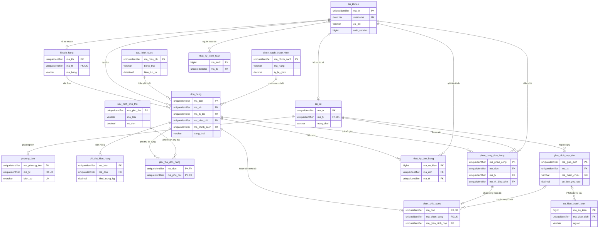

# ERD designV2

Sơ đồ quan hệ của 16 bảng nghiệp vụ trong migration V1. Khóa và các quan hệ lấy từ
`V1__create_business_tables.sql`; các view, hàm và thủ tục không phải bảng nên không vẽ.

`phan_chia_cuoc` chỉ có khi tài xế xác nhận đã giao và thu đủ cước. Khóa ngoại
`ma_giao_dich_nop` có thể NULL; khi giao dịch được xác minh `KHONG_THU`, thủ tục tháo
liên kết này để khoản được nộp lại. `su_kien_thanh_toan.ma_giao_dich` cũng có thể NULL
để lưu callback không nhận diện được giao dịch.
