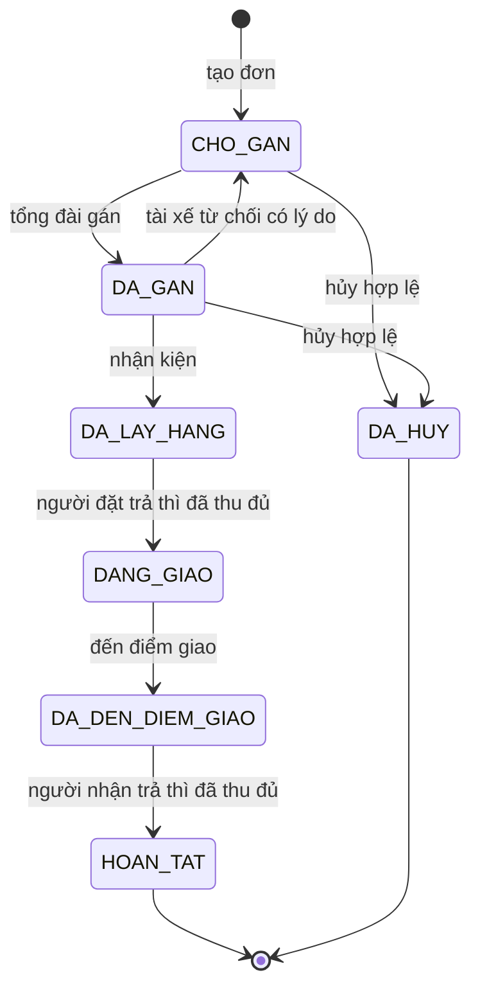
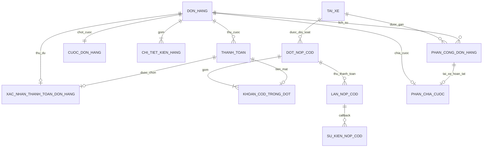
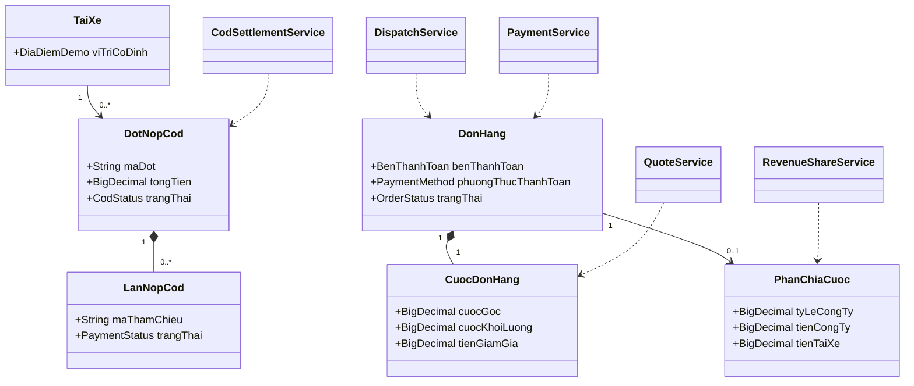
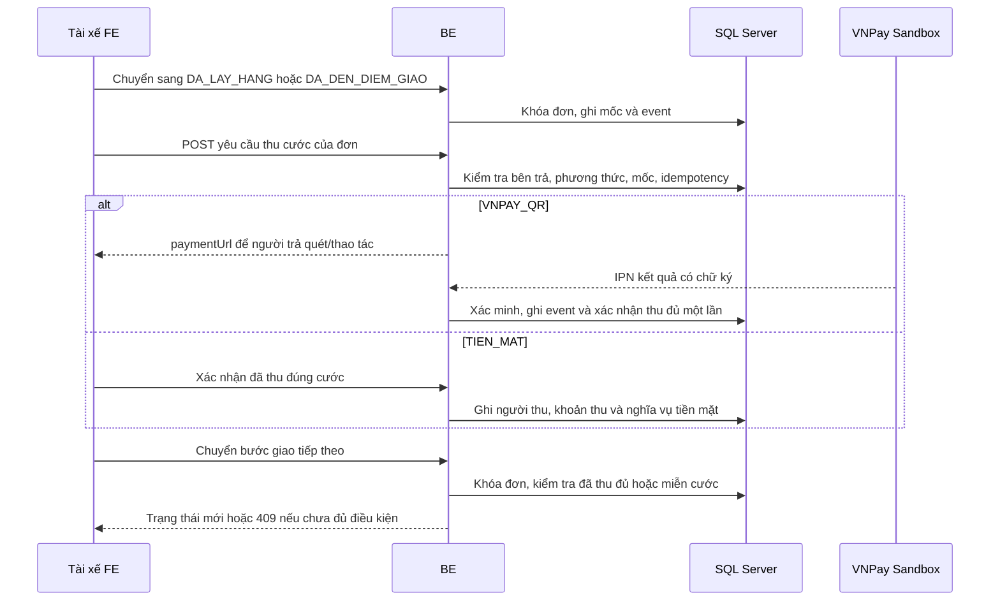
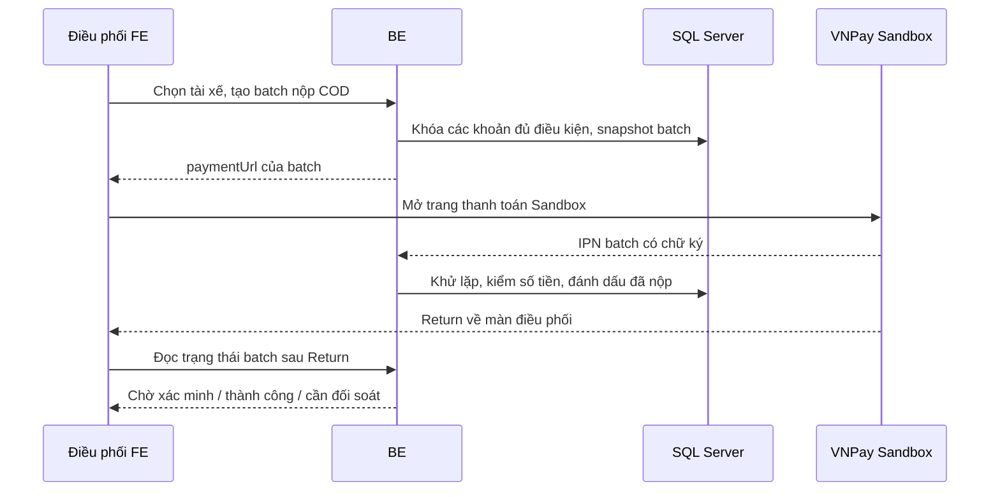

# TX1 — Thiết kế đích cho luồng giao hàng mới

**Trạng thái:** thiết kế đích ngày 14/10/2026, chưa phải schema hoặc hành vi backend đang chạy. [designV1](designV1.md) mô tả 19 bảng và các quy tắc hiện đã triển khai; tài liệu này là phần thay đổi có chủ đích để TX3–TX7 thực hiện bằng migration mới. Các cột và bảng không nêu ở đây giữ quy tắc designV1. [Contract API đích](../api/TX1-contract.md) dùng cùng tên trường và trạng thái.

## 1. Quy tắc nghiệp vụ chốt

| Vấn đề | Quyết định |
| --- | --- |
| Bên trả cước | `NGUOI_DAT` là khách sở hữu đơn, kể cả khi tổng đài tạo hộ; `NGUOI_NHAN` là người ở điểm giao, không bắt buộc có tài khoản. Không dùng `NGUOI_GUI` để tránh nhầm người tạo hộ. |
| Phương thức | `TIEN_MAT` hoặc `VNPAY_QR`, chọn lúc đặt và không đổi sau khi tạo. Đây là cước vận chuyển, chưa quản lý giá trị hàng hóa hoặc COD hàng hóa. |
| Mốc thu | Người đặt trả sau `DA_LAY_HANG`, trước `DANG_GIAO`. Người nhận trả sau `DA_DEN_DIEM_GIAO`, trước `HOAN_TAT`. Đơn miễn cước đi tiếp không tạo payment. |
| Tài xế chấp nhận | Không thêm trạng thái/nút chấp nhận riêng: chuyển `DA_GAN → DA_LAY_HANG` nghĩa là tài xế bắt đầu thực hiện; vẫn có thể từ chối có lý do khi còn `DA_GAN`. |
| Cước | `tongKg = tổng khoiLuongKg của các kiện`; `cuocGoc = HALF_UP(cuocCoBan + km × donGiaKm)`; `soBuocKg = CEIL(MAX(0, tongKg − kgMienPhi) / buocKg)`; `cuocKhoiLuong = soBuocKg × donGiaBuocKg`; `tongCuoc = cuocGoc + cuocKhoiLuong + phụThu − giamGia`. Giảm hạng áp trên tổng trước giảm, làm tròn `HALF_UP` đến đồng và không vượt tổng trước giảm. Mức kg miễn phí, bước kg, giá mỗi bước và giới hạn cân nặng do TX3 cấu hình trong DB, không hardcode ở FE. |
| Chia cước | Sau khi **đơn hoàn tất và cước được xác nhận thu đủ**, tạo tối đa một bản phân chia: công ty `HALF_UP(tongCuoc × 20%)` nguyên đồng; tài xế `tongCuoc − phanCongTy`. Đơn miễn cước có hai phần bằng 0. Đây là phần doanh thu/thu nhập phải trả, không phải lợi nhuận ròng hoặc chuyển lương thật. |
| Tiền mặt | Xác nhận đúng người/đúng mốc là bằng chứng khách đã trả cước **cho tài xế thu hộ**. Đồng thời phát sinh nghĩa vụ tài xế đang giữ tiền mặt; khách không phải trả thêm khi tài xế chưa nộp COD. |
| Nộp COD | Điều phối chọn tài xế, bấm trên tab đối soát và được chuyển sang trang VNPay Sandbox để mô phỏng nộp **toàn bộ cước tiền mặt đủ điều kiện đang giữ**. Không yêu cầu tài xế đăng nhập. Batch gắn `maTx`, nhưng không chứng minh tài xế là người thao tác/có chuyển tiền thật. Chỉ IPN hoặc truy vấn xác minh mới đánh dấu đã nộp; giao dịch này không được cộng thêm vào tiền cước khách trả. |

## 2. Trạng thái đơn, quyền và điều kiện chuyển

Trạng thái thanh toán (`CHUA_THANH_TOAN`, `DANG_XU_LY`, `DA_THANH_TOAN`, `MIEN_CUOC`, `CAN_DOI_SOAT`) độc lập với trạng thái giao hàng. Màn hình suy ra “đang chờ thu tại điểm lấy/điểm giao” từ bên trả, trạng thái đơn và payment; không thêm trạng thái đơn chỉ để phản ánh chờ IPN.

| Từ → đến | Người thực hiện | Điều kiện bắt buộc và tác động cùng transaction |
| --- | --- | --- |
| Chưa có → `CHO_GAN` | Khách hoặc tổng đài tạo hộ | Báo giá đúng khách/địa chỉ/kiện/bên trả/phương thức, chưa hết hạn; lưu cước, kiện, tọa độ đã chuẩn hóa, lựa chọn thanh toán, event và idempotency. |
| `CHO_GAN → DA_GAN` | Tổng đài | Tài xế đủ điều kiện, rảnh và chưa từ chối đơn; ghi phân công và event. Khoảng cách tài xế → điểm lấy chỉ là gợi ý, phải kiểm tra lại khi gán. |
| `DA_GAN → CHO_GAN` | Tài xế được gán | Từ chối có lý do; đóng phân công `TU_CHOI`, giải phóng tài xế; không gán lại người đó cho cùng đơn. |
| `DA_GAN → DA_LAY_HANG` | Tài xế được gán | Xác nhận đã đến điểm lấy và nhận kiện; ghi event. Nếu người đặt trả, đây là mốc mở yêu cầu thu cước. |
| `DA_LAY_HANG → DANG_GIAO` | Tài xế được gán | Người đặt trả: cước 0 hoặc đã có xác nhận thu đủ; người nhận trả: chưa cần thu. BE khóa/kiểm tra lại payment dưới khóa đơn. |
| `DANG_GIAO → DA_DEN_DIEM_GIAO` | Tài xế được gán | Xác nhận đã đến điểm giao; ghi event. Nếu người nhận trả, đây là mốc mở yêu cầu thu cước. |
| `DA_DEN_DIEM_GIAO → HOAN_TAT` | Tài xế được gán | Người nhận trả: cước 0 hoặc đã có xác nhận thu đủ; người đặt trả: xác nhận đã thu tại điểm lấy vẫn hợp lệ. Đóng phân công `HOAN_TAT`, giải phóng tài xế, ghi event; tạo phần chia 20/80 một lần nếu đủ điều kiện. |
| `CHO_GAN`/`DA_GAN → DA_HUY` | Khách sở hữu hoặc tổng đài | Giữ quy tắc <300 giây từ lúc tạo, lý do bắt buộc; nếu đã gán thì đóng phân công và giải phóng tài xế. Không hủy bằng API này sau `DA_LAY_HANG`. |

Sự cố `KHONG_LIEN_LAC_DUOC`/`TU_CHOI_NHAN` được ghi khi `DANG_GIAO` hoặc `DA_DEN_DIEM_GIAO`, không tự đổi thành `HOAN_TAT`. Nếu đã thu trước khi sự cố khiến đơn không hoàn tất, giữ sự thật khoản thu và đánh dấu cần xử lý/đối soát; **không chia 20/80**, không tự hoàn tiền hoặc xóa payment. Cần có kịch bản demo kết thúc hoặc biên bản xử lý ngoài phạm vi cho đơn treo, không báo là giao thành công.

## 3. Thiết kế ERD thay đổi

Các tên dưới đây là **tên đích**, chưa tồn tại trong DB. Cardinality của bảng cũ giữ theo [designV1 mục 5](designV1.md#5-quan-hệ-để-dựng-erd); sơ đồ này chỉ vẽ phần cần thêm/đổi. Không lưu `tongCuoc` hay `maTx` hiện tại như cột dư trên `don_hang`; tài xế hoàn tất lấy từ phân công.

| Bảng | Cột thêm hoặc mới | Ràng buộc cần triển khai |
| --- | --- | --- |
| `tai_xe` | `dia_chi_vi_tri_demo`, `vi_do_demo`, `kinh_do_demo`, `nguon_vi_tri`, `vi_tri_cap_nhat_luc` | Vị trí/tọa độ là một bộ cùng NULL hoặc cùng có; vĩ độ/kinh độ hợp lệ. Chỉ nguồn `DEMO_CO_DINH` ở phạm vi này; tài xế thiếu vị trí không được tuyên bố xếp hạng gần nhất. |
| `don_hang` | `ben_thanh_toan`, `phuong_thuc_thanh_toan`, tọa độ chuẩn hóa của điểm lấy/giao | Bất biến sau tạo; với đơn mới đều bắt buộc. Tọa độ chỉ để gợi ý/bản đồ, địa chỉ chuẩn và km chốt vẫn là nguồn tạo cước. Thêm enum `DA_DEN_DIEM_GIAO` và quy tắc chronology. |
| `cau_hinh_cuoc` | `kg_mien_phi`, `buoc_kg`, `don_gia_buoc_kg`, `kg_toi_da` | Số không âm, `buoc_kg>0`, `kg_toi_da>0`; phiên bản công bố bất biến. TX3 chốt số demo, cấu hình không nằm FE. |
| `cuoc_don_hang` | `cuoc_khoi_luong` | Không âm, làm tròn nguyên đồng và bất biến. `cuoc_goc` giữ nghĩa cũ (cơ bản + km); `tongCuoc` suy từ cước gốc + cước khối lượng + phụ thu − giảm. |
| `thanh_toan`, `xac_nhan_thanh_toan_don_hang` | Mở điều kiện tạo/xác nhận trước `HOAN_TAT`, giữ `ma_don`/`ma_giao_dich` và unique cặp hiện có | Payment luôn là **cước đơn**, không dùng cho nộp COD. Phương thức phải khớp lựa chọn bất biến trên đơn. Tiền mặt gắn tài xế đang được gán ở đúng mốc; online gắn sự kiện provider. Một đơn vẫn tối đa một xác nhận thu đủ. |
| `dot_nop_cod` | `ma_dot`, `ma_tx`, `ma_tk_dieu_phoi`, `tao_luc`, `tong_tien`, `trang_thai` | Một batch snapshot của một tài xế; người bấm là tổng đài. `tong_tien` bất biến, phải bằng tổng khoản liên kết khi tạo. Trạng thái chờ/thành công/thất bại/chưa rõ; không tự coi Return là thành công. |
| `khoan_cod_trong_dot` | `ma_dot`, `ma_giao_dich_cuoc`, `so_tien` | FK tới batch và payment tiền mặt đã xác nhận đủ cho đơn **hoàn tất** cùng tài xế; số tiền snapshot khớp cước thực thu. Một khoản chỉ có một batch chưa giải quyết hoặc thành công; retry thanh toán trong cùng batch. |
| `lan_nop_cod` | `ma_lan_nop`, `ma_dot`, `ma_tham_chieu`, `trang_thai`, `payment_url`, `tao_luc`, `thu_luc`, `so_tien_thuc_nhan` | Nhiều lần thử theo batch khi lần trước đã giải quyết thất bại; một lần đang chờ/chưa rõ. Mã tham chiếu VNPay riêng tiền cước (`FREIGHT-`) và nộp COD (`COD-`) để callback định tuyến đúng; mã đối tác/idempotency duy nhất. |
| `su_kien_nop_cod` | `ma_su_kien`, `ma_lan_nop` nullable, `nguon`, `khoa_su_kien`, `chu_ky_hop_le`, `ket_qua`, `nhan_luc`, `noi_dung_json` | Lưu và khử lặp IPN/Return/Query, kể cả thông điệp không khớp. Không ép event nộp COD vào `su_kien_thanh_toan` vốn chỉ tham chiếu cước đơn. |
| `phan_chia_cuoc` | `ma_don` PK/FK, `ma_phan_cong` FK, `ma_giao_dich_cuoc` FK nullable khi miễn cước, `ty_le_cong_ty`, `tien_cong_ty`, `tien_tai_xe`, `ghi_nhan_luc` | Một đơn tối đa một bản; tài xế từ phân công `HOAN_TAT`, giao dịch từ xác nhận thu đủ của chính đơn. Snapshot tỷ lệ và số tiền; `tien_cong_ty+tien_tai_xe=tongCuoc`. Điều kiện chi trả tiền mặt suy từ batch nộp COD, không từ `walletBalance` FE. |

Các `||--o|` trong ERD biểu diễn bội số nghiệp vụ tại một thời điểm; điều kiện “cùng đơn/cùng tài xế”, tổng batch và không nhân tiền là ràng buộc liên bảng phải kiểm tra trong service/transaction và test, không chỉ bằng FK riêng lẻ. Không xóa vật lý khoản thu, batch, sự kiện hoặc phần chia đã ghi nhận. Khi thêm migration, cần kiểm tra dữ liệu đơn cũ: không gán đại `NGUOI_DAT`/`TIEN_MAT` nếu lịch sử không chứng minh điều đó. Môi trường demo có thể reset/seed sạch; môi trường giữ dữ liệu phải có quy tắc backfill/nhãn legacy riêng trước khi đặt `NOT NULL` cho đơn cũ.

## 4. Trách nhiệm lớp để cập nhật Class Diagram

Đây là sơ đồ trách nhiệm mục tiêu, không bắt buộc tên lớp Java phải trùng tuyệt đối. Controller nhận request và xác thực/ủy quyền; Service giữ quy tắc, transaction và khóa; DAO giữ truy vấn; Goong/VNPay adapter giữ giao thức ngoài. Không đặt công thức cước hoặc 20/80 trong React, servlet hay enum.

## 5. Sequence của hai khoản tiền khác nhau

## 6. Sổ tiền và mốc báo cáo

- `tienThucThuCuaKhach` ghi theo `thu_luc` của payment cước, kể cả khách trả trước khi đơn hoàn tất. Thu tiền mặt là thu hộ; không có nghĩa công ty đã cầm tiền mặt. `tienNopCod` ghi ở batch theo thời điểm IPN nộp thành công và là chỉ tiêu đối soát riêng, **không cộng** vào `tienThucThuCuaKhach`.
- `giaTriDonHoanTat` ghi theo `hoanTatLuc`. Phần công ty/tài xế 20/80 ghi theo `ghiNhanLuc = max(hoanTatLuc, thuLuc của khoản được xác nhận đủ)`, vì cần cả giao xong và thu đủ; đơn miễn cước dùng `hoanTatLuc`. `cuocConPhaiThuCuoiKy` chỉ tính đơn đã hoàn tất đến cuối mốc mà chưa có xác nhận thu đủ trước mốc; khoản thu cần đối soát không tự trừ công nợ.
- `tienMatTaiXeDangGiu` là số tiền mặt đã xác nhận thu hộ chưa thuộc batch COD thành công, tách khoản trên đơn chưa hoàn tất/cần xử lý. `thuNhapTaiXeDuDieuKienChiTra` của đơn tiền mặt chỉ hiện sau batch đã nộp; đơn VNPay hiện sau hoàn tất và xác nhận thu đủ. Không có bảng ví/rút tiền thật ở phạm vi TX.

## 7. Thứ tự migration và kiểm tra

1. TX3/TX4: thêm cột giá theo kg, vị trí/tọa độ demo, lựa chọn bên/phương thức trả và tọa độ điểm giao nhận; cập nhật quote/order atomically. Seed giá/vị trí có kiểm tra Goong trên môi trường demo.
2. TX5/TX6: thêm `DA_DEN_DIEM_GIAO`, cập nhật CHECK/triggers/enum/transition, mở thời điểm payment và xác nhận thu đủ trước hoàn tất; cập nhật quyền, sự kiện, test cạnh tranh.
3. TX7: tạo bảng nộp COD/sự kiện/phần chia, unique/FK/kiểm tổng; mở API/báo cáo, thử IPN giả lập và Sandbox thật riêng.
4. Mỗi bước: migration mới, entity/DAO/service, OpenAPI đang chạy, Postman, test SQL Server và tài liệu cùng PR. Không sửa V1–V4 đã dùng; kiểm tra backfill dữ liệu cũ hoặc reset DB demo có ghi rõ. Không đánh dấu thiết kế này “đã triển khai” trước khi BE/FE/test tương ứng đạt.
